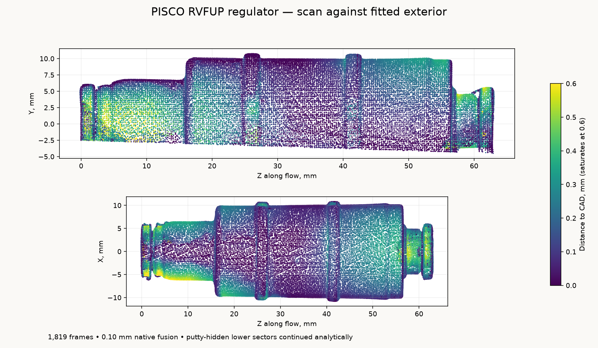

# PISCO secondary regulator and Fluidfit check

The PISCO RVFUP1/4–1/4-0.3 preset regulator is the appliance's in-machine CO₂
secondary ([bom.md §4](/hardware/ledger/bom.md)). The
[OEM catalog](https://shop.pisco.com/wp-content/themes/agency-ecommerce/assets/images/preset-regulator.pdf),
PDF page 4, gives a **62.4 mm nominal length**, **21.5 mm maximum diameter**,
20 mm secondary body diameter and **17 mm insertion** for both 6.35 mm sockets.
Its L1=37.7 and L2=20.2 locate nominal shoulders at Z24.7 and Z42.2.

The native exterior follows the sprayed specimen's MINI 2 scan: **62.814 mm
between release-face datums** and **21.655 mm maximum fitted diameter**. The
STEP retains four named bodies: round molded housing, outlet fitting and two
release rings. The separate portable STL unites them into one watertight
exterior. Its long-neck inlet is `(0,0,0)` and short-neck outlet is
`(0,0,62.814)`; normal flow is **+Z**. Release rings are in their captured free
positions. Recorded decimal places are reproducible model datums, not calibrated
absolute accuracy.

The selected preset is 0.3 MPa, listed as 44 psi, with service pressure up to
145 psi. Its specification medium is air, and it allows reverse free flow;
the downstream check remains a separate component. CO₂ duty is not established
by this geometry. The model's PBT body, aluminum outlet fitting and POM release
rings follow the OEM material identities; their hidden boundaries are display
interpretations. Visible inlet-guide geometry follows the capture, while deeper
socket closures retain the catalog's 17 mm insertion.

## PISCO capture and fit

Derek sprayed, putty-mounted and rotated the specimen. Revo Scan 6.3.2 recorded
**1,819 frames** with the MINI 2, High Accuracy / Feature / Normal, a 120–250 mm
range, colour and base removal off. Manual depth exposure 2 captured the light
ends through approximately frame 1,168; exposure 6 captured the dark housing
through the finish. Native **0.10 mm fusion** produced **628,949 points**.
The archived native cloud has no smoothing, isolation, hole filling or rescaling.

The single retained native project, frame database, calibration files, preview,
fused cloud and SHA-256 capture manifest are in
`~/Documents/3D Scans/2026-10-29-pisco-rvfup-regulator/`. The same directory holds
registered observations and portable STEP/STL files.

[`analyze_regulator_scan.py`](analyze_regulator_scan.py) fits the broad marker
table and exposed round housing, then locates the release-face patches. The
registration is rigid at native scale. A fixed plane above 21 mm from the table
removes the putty and markers, retaining **305,203 observations** without
distance-to-CAD rejection. Outward-facing 95th-percentile radii in 0.15 mm axial
bins, a three-bin median and a 0.04 mm radial simplification define the exterior.
[`regulator-scan-evidence.json`](regulator-scan-evidence.json) retains transforms,
physical selections, fit residuals and source hashes;
[`regulator-scan-parameters.json`](regulator-scan-parameters.json) supplies the generator.



[`regulator-scan-model-check.json`](regulator-scan-model-check.json) compares
**37,393 observations** at 0.30 mm sampling against the reopened four-body STEP
tessellated at 0.025 mm. Median distance is **0.135 mm**, the 95th percentile
**0.448 mm**, and **96.7%** lie within 0.50 mm. Every native body is valid, and
the united STL is watertight. These are scan/model discrepancies, not
manufacturing tolerances.

Putty-hidden lower sectors continue the fitted rotational forms. Embossed
markings, molding seams and collet finger slots are omitted. Material boundaries
and hidden joint continuations are display interpretations. The scan does not
qualify internal seals, tube retention, insertion stops or pressure performance;
paint thickness and absolute optical scale are not independently calibrated.

## Fluidfit check reference

The Fluidfit HCVU 1/4–1/4 check is not part of the appliance, whose two check
valves are both the [neoFit ACHV44-E](../neofit-achv44-check/README.md). The
HCVU is modeled from its
[exact OEM imperial drawing](https://www.fluidfit.net/eng/open_content/product/view.php?pm_no=262).
It has 6.35 mm push-connect sockets at both ends, 45.5 mm overall length,
15.5 mm maximum diameter and 16.1 mm tube insertion from each mouth.
The requested G color variant uses this family's dimensional row.

The native flow axis is **+Z**: inlet mouth `(0,0,0)`, outlet mouth
`(0,0,45.5)`. The OEM arrow points from the short stepped socket end toward
the long cylindrical-body end. The modeled blind sockets reach their full
16.1 mm depths, so inserted stems meet their nominal stop rather than a
shallow display cap. The valve mechanism is not modeled.

The body profile, necks and separate release collets are estimates from the
OEM outline. Overall length, maximum diameter and insertion depths follow
the table. The manufacturer catalog includes air/gas applications for its
POM family; this reference does not establish exact CO₂ duty qualification.

`geometry/candidate-regulator.step` and `geometry/candidate-check.step` are
native assemblies with separate body and collet solids. The corresponding
NPZ files have `v` and `f` arrays in the same frame.
`build.py` is editable; `dimensions.json` separates published dimensions,
the PISCO fitted exterior, Fluidfit estimated details and source evidence.
`model.py` supplies a NumPy-only `library()`, transformed `ports(kind)` and
an `instance(kind)` helper, where `kind` is `regulator` or `check`.

Rebuild both references manually through the CAD queue:

```sh
PYTHONPATH=. tmp/takeover/cadq "Compact inline reference models" -- tools/cad-venv/bin/python hardware/reference/compact-inline-candidates/build.py
```

To derive and export only the captured PISCO reference:

```sh
tools/cad-venv/bin/python hardware/reference/compact-inline-candidates/analyze_regulator_scan.py
tools/cad-venv/bin/python hardware/reference/compact-inline-candidates/build.py --regulator-only
tools/cad-venv/bin/python hardware/reference/compact-inline-candidates/validate_regulator_scan.py
```
