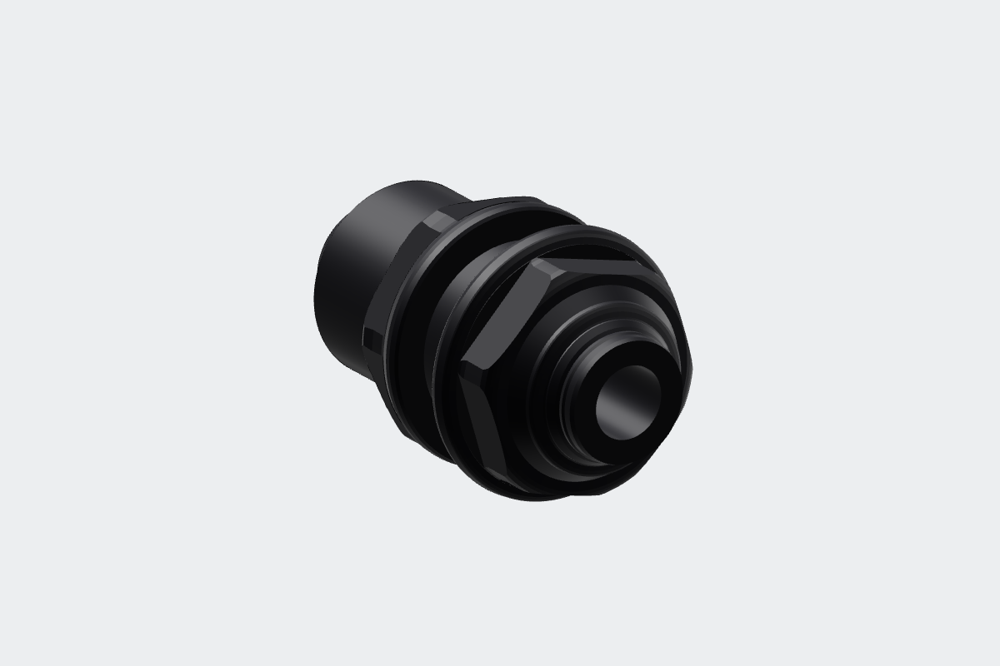
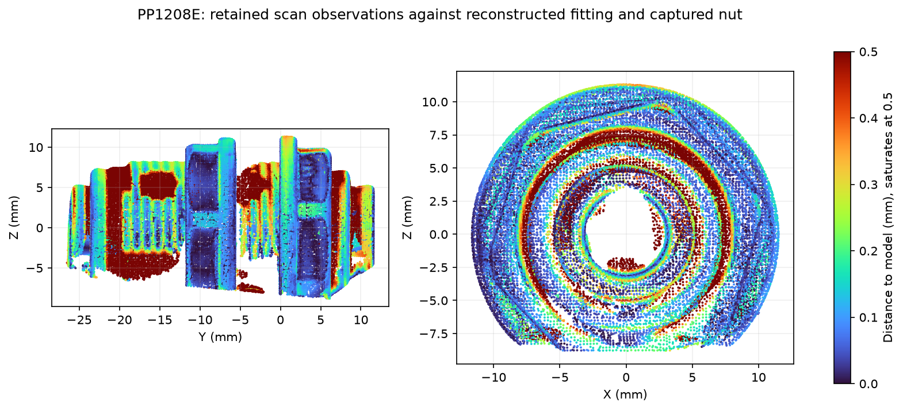

# John Guest PP1208E 1/4-inch bulkhead union

**HSM-0059**, black polypropylene union at the rear **SODA** station. The
reference follows the prepared MINI 2 scan at native scale. The fitting and its
separate nut are two named solids; both exported mesh shells are watertight.

| Feature | Fitted reference, mm |
| --- | ---: |
| Release-face datum span | 37.553 |
| Outboard release face from panel seat | +11.521 |
| Inboard release face from panel seat | -26.031 |
| Fixed wrench hex, across flats | 18.835 |
| Nut wrench hex, across flats | 20.001 |
| Fixed flange maximum diameter | 23.343 |
| Captured flange-to-nut gap | 5.692 |
| Nut axial depth | 5.940 |

The frame has **+Y outboard**, +Z up and **Y0 at the fixed flange's panel-seating
face**. `port(1)` and `port(-1)` supply the exposed mouth datums and outward axes.
The installed assembly selects `fitting` and `nut` independently and sets the
nut's bearing face 6 mm inboard of the fixed flange. The short blue tube uses
the manufacturer's 15.7 mm insertion depth. The meter outlet and bulkhead
inboard release-face datums share Y445.269. The receiver cavity and accepted
inlet holder follow the meter's installed frame.

The [manufacturer's dimensional sheet](source/polypropylene-bulkhead-dimensions.pdf)
([original](https://www.johnguest.com/sites/jg/files/2023-04/JG%20Drinks%20Polypropylene%20Bulkhead%20Connector%20Data%20Sheet.pdf))
specifies a 17 mm round mounting hole, 3/8-inch BSP barrel, nominal 19/20 mm
wrench flats, 13.5 mm maximum bare panel span and 5.3 mm through bore. Its
34.6 mm overall dimension is explicitly taken with the collets in the release
position; the reference retains the exposed faces in the captured free positions.

## Capture and reconstruction

Derek sprayed, putty-mounted, focused and rotated the specimen. Revo Scan 6.3.2
recorded **876 frames**, MINI 2 High Accuracy / Feature / Normal, automatic
depth exposure, colour and base removal off, and a 120-250 mm range. Native
**0.10 mm fusion** produced **395,118 points**. The cloud is not rescaled,
smoothed, isolated or hole-filled.

One native project, including its frame database, calibration files, raw preview,
fused cloud and SHA-256 manifest, is retained in
`~/Documents/3D Scans/2026-11-03-jg-pp1208e-bulkhead/`.

[analyze_scan.py](https://github.com/derekbreden/homesodamachine/blob/a518a57a878f02d9ac5b8b638c1c5883cadf6669/hardware/reference/jg-bulkhead-union/analyze_scan.py) fits the marker-table plane and common end
axis, then the panel, nut and mouth faces. Physical height, axial and radial
bounds remove the table and putty before any CAD comparison, retaining **256,859
observations**. Hex-flat normal clusters establish the wrench envelopes. Turned
profiles use outward-facing 97.5th-percentile radii in 0.125 mm bins, a three-bin
median and 0.035 mm radial simplification. The transforms, selections and residuals
are in [`scan-evidence.json`](scan-evidence.json); the reconstruction numbers are in
[`reference-parameters.json`](reference-parameters.json).

[`jg_bulkhead_union.rs`](jg_bulkhead_union.rs) constructs the turned profiles and
wrench flats in Rust. The barrel is a smooth thread-crest envelope. The bore,
mouth closures and hidden nut clearance are display geometry; thread grooves,
collet slots and molded markings are omitted. Hidden lower sectors continue the
fitted turned and hexagonal forms.

[`scan-model-check.json`](scan-model-check.json) compares **45,573 observations**
at 0.25 mm sampling with the reopened exported STL. Median distance is **0.120
mm**, the 95th percentile **0.946 mm**, and **83.3%** lie within 0.50 mm. The nut's
95th percentile is **0.170 mm**; thread roots and free-collet details account for
larger local discrepancies. All physically retained observations remain eligible
for comparison. These are model discrepancies, not dimensional tolerances.
Paint thickness and absolute optical scale are not independently calibrated.

The STEP, fine model and viewer payload are frozen inputs declared in
[`frozen-asset.json`](frozen-asset.json). Source derivation:

The source derivations are preserved at their recorded revision: [analyze_scan.py](https://github.com/derekbreden/homesodamachine/blob/a518a57a878f02d9ac5b8b638c1c5883cadf6669/hardware/reference/jg-bulkhead-union/analyze_scan.py), [jg_bulkhead_union.py](https://github.com/derekbreden/homesodamachine/blob/a518a57a878f02d9ac5b8b638c1c5883cadf6669/hardware/reference/jg-bulkhead-union/jg_bulkhead_union.py).

The native `jg-bulkhead-reference` producer is defined in [jg_bulkhead_union.rs](jg_bulkhead_union.rs). It takes a JSON recipe containing the retained parameters and the material catalog colour, followed by an output directory.
