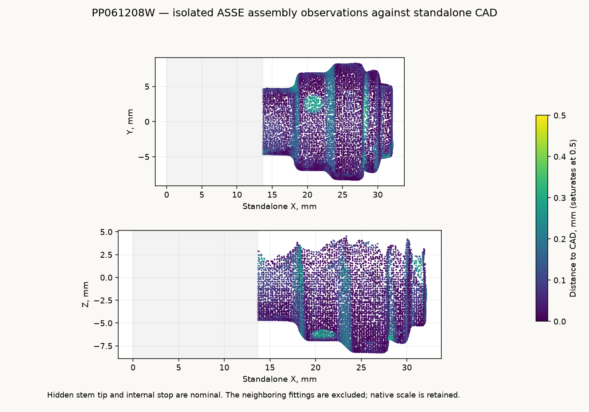

# John Guest PP061208W reducer

Standalone editable reference for the **3/8-inch male stem × 1/4-inch
push-connect reducer** captured in the [threaded ASSE chain](../asse1022-threaded-chain/README.md).
The STEP contains two named solids: `body_and_stem` and `release_collet`.
The portable STL contains the same two watertight shells.

| Feature | Reference, mm | Basis |
| --- | ---: | --- |
| Stem outside diameter | 9.525 | Nominal 3/8 inch |
| Stem tip to shoulder | 18.290 | Retained nominal hidden-stem completion |
| Stem tip to captured socket release face | 31.926 | Measured shoulder-to-face span plus nominal stem |
| Shoulder to socket release face | 13.636 | Fitted exposed face planes |
| Maximum body diameter | 16.586 | Assembly-scan radial profile |
| Collet projection past fixed nose | 1.587 | Captured exterior split |
| Accepted tube outside diameter | 6.350 | Nominal 1/4 inch |

The standalone frame puts the nominal male tip at **X0**, with the part extending
along **+X**, centred on Y and Z. The male stem enters a host at -X; the socket
opens +X. `stem_tip()`, `stem_shoulder()` and `tube_port()` supply these datums.
`build()` returns an assembly-compatible compound; `parts()` and
`build_assembly()` expose the fixed fitting and separate collet.
`captured_transform()` and `in_assembly()` place it in the preserved chain pose.
The stem-length, diameter and build interfaces used by the pump-barb joint are
retained; a 10 mm stem trim is valid in the standalone model.

## Observed exterior and nominal completion

The source is the existing **1,191-frame MINI 2 capture**, fused at **0.10 mm**
in Revo Scan 6.3.2. No new capture or raw-frame copy is required. The retained
native source remains under
`~/Documents/3D Scans/2026-10-29-asse1022-threaded-chain/`.
Standalone STEP/STL files, preview, source manifest and one-off check scripts
are under `~/Documents/3D Scans/2026-10-30-jg-pp061208w-reducer/`.

The component axis and compact radial profile come from the chain's
[`reference-parameters.json`](../asse1022-threaded-chain/reference-parameters.json).
Independent exposed annular patches locate the shoulder and release-face
planes. The neighboring flare-adapter mouth and inserted tee stem are excluded
by physical part bounds. **62,962 observations** remain at native scale.
[`scan-evidence.json`](scan-evidence.json) records the source hashes, fitted
planes, pose, selections and nominal completions.
[`reference-parameters.json`](reference-parameters.json) is frozen into the
model source, so layout imports need no measurement JSON or scan archive.

The assembly hides the male tip. Its 18.29 mm tip-to-shoulder length is nominal,
and does not establish an insertion depth or whether the stem bottoms in a
host. The 0.6 mm tip lead-in, 6.48/5.84 mm stepped bore and 14.10 mm fixed-face
to-stop depth are unmeasured display geometry retained from the reference's
nominal inputs. They supply no seal, grip, hydraulic or release-travel model.
The captured socket face describes the assembled collet position.

Putty-hidden sectors continue the fitted rotational form. Fine collet slots and
molded markings are omitted. Coating thickness and absolute optical scale are
not independently calibrated; the source cloud is not rescaled.



[`scan-model-check.json`](scan-model-check.json) compares **11,524 observations**
at 0.25 mm sampling against the reopened STEP tessellated at 0.025 mm. Median
distance is **0.055 mm**, the 95th percentile **0.203 mm**, and the maximum
**0.353 mm**. Every physically isolated observation remains in the check;
none is rejected by CAD distance. These are scan/model differences, not
manufacturing tolerances or measurements of the hidden stem and internals.

Rebuild the standalone reference from the repository root:

```sh
tools/cad-venv/bin/python hardware/reference/jg-pp061208w/jg_pp061208w.py
```

Add `--stl /absolute/output/path.stl` to export a portable mesh.
