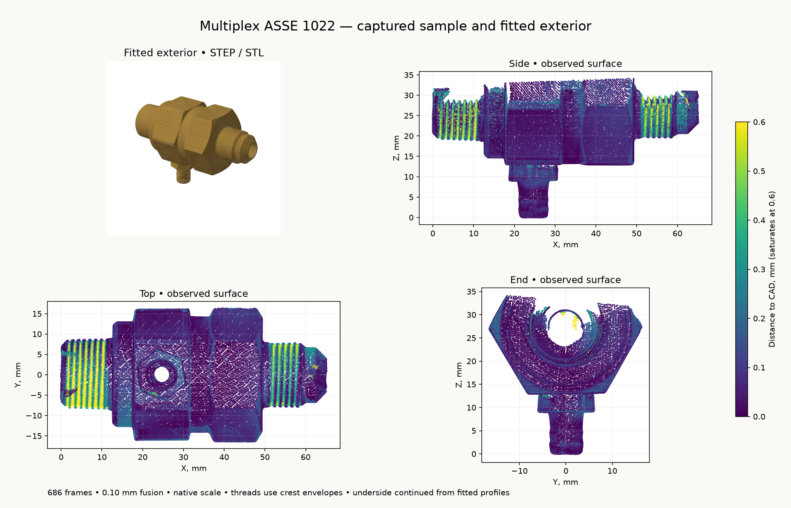

# Multiplex 19-0897 ASSE 1022

The reference represents the received backflow preventer's external form, fitted
to a coated Revopoint MINI 2 capture. It includes both wrench sections, clipped
corners, the narrow body waist, inlet collar, tapered inlet thread envelope,
outlet thread and flare nose, and the vent stem and hex base. It is an exterior
for placement and mounting, not an internal hydraulic or manufacturing model.



| Feature | Model, mm |
| --- | ---: |
| Inlet rim to outlet nose | 65.05 |
| Inlet rim to collar shoulder | 12.70 |
| Outlet shoulder to flare nose | 15.85 |
| Main wrench across flats | 28.65 |
| Outlet cap across flats | 28.73 |
| Maximum corner envelope diameter | 33.10 |
| Flow-axis height above vent tip | 27.45 |
| Vent centre from inlet rim | X 24.65, Y 0.07 |
| Vent tip to hex-base shoulder | 8.95 |
| Fitted vent stem diameter | 6.926 |
| Maximum modeled stem-root diameter | 7.70 |

The frame has **+X from inlet to outlet**, the inlet rim at X = 0, and the
coaxial ports at Y = 0, Z = 27.45. The vent points along −Z and ends at Z = 0.
`inlet()`, `outlet()` and `vent()` return interface positions and outward axes.
The two independently fitted wrench axes differ slightly; the CAD uses their
mean axis and coaxial ports. The main wrench and cap retain separate clocks
and across-flat dimensions.

## Capture and fidelity

Derek prepared the sample with paint and putty and placed it on the rotating
turntable. Revo Scan 6.3.2 recorded **686 frames**, MINI 2 High Accuracy / Feature /
Normal, colour off, base removal off, depth exposure value 1, and a 120–250 mm
range. Native fusion at **0.10 mm** produced **522,051 points**. No smoothing,
isolation, hole filling or rescaling is applied to the archived native cloud.

The complete native project, frame database, calibration files, preview, fused
cloud and SHA-256 capture manifest are preserved in
`~/Documents/3D Scans/2026-10-29-multiplex-asse1022/`. That directory also holds
the registered observations and portable STL. The STEP and its viewer payload
are generated beside this README and published through the CAD artifact store.

[`analyze_scan.py`](analyze_scan.py) finds the broad marker-table plane, fits the
three exposed flats of each wrench section, and fits the vent stem. The fixed
support-plane selection retains **416,569 observations** above 15.5 mm from the
table. It removes the putty and table without selecting points by their distance
to the CAD. [`scan-evidence.json`](scan-evidence.json) records source hashes,
the unit-scale rigid transform, selections, plane residuals and radial profiles.

[`scan-model-check.json`](scan-model-check.json) compares 53,646 observations at
0.30 mm sampling with the analytic solid tessellated at 0.025 mm. Median distance
is **0.065 mm**, the 95th percentile is **0.453 mm**, and **96.0%** lie within
0.50 mm. The main wrench, outlet cap and vent have 95th-percentile distances of
0.165, 0.154 and 0.159 mm respectively. The maximum discrepancy is 2.12 mm at a
recessed outlet-mouth patch that the simplified display bore does not reproduce.
All retained observations remain in that comparison.

The underside obscured by putty uses continuation of the fitted regular hexes
and turned profiles. Threads use smooth crest envelopes. Mouths are display
recesses with unqualified blind closures; the scan does not establish hidden
checks, springs, seals, full bore geometry, sealing engagement or pressure
performance. Optical scale and paint thickness are not independently calibrated;
fusion spacing and fit residuals are not absolute dimensional tolerances. This
reference does not qualify cuff or drain-sleeve fits.

```sh
tools/cad-venv/bin/python hardware/reference/multiplex-asse1022/analyze_scan.py
tools/cad-venv/bin/python hardware/reference/multiplex-asse1022/multiplex_asse1022.py
tools/cad-venv/bin/python hardware/reference/multiplex-asse1022/validate_scan.py
```

Pass `--stl /absolute/output/path.stl` to the model generator for a portable mesh.
