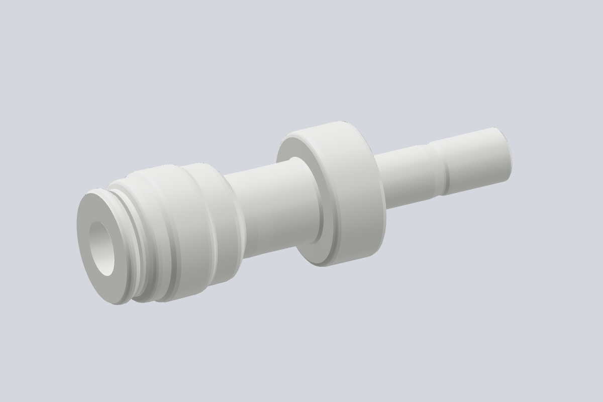
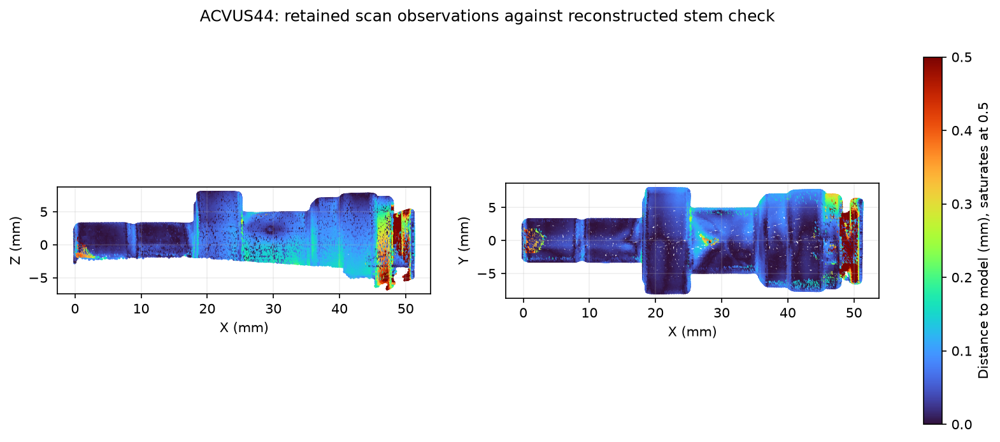

# neoFit ACVUS44 stem check valve

**HSM-000383**, a white acetal check valve with a 1/4-inch male stem and a
1/4-inch tube socket. Two installed instances use this reference: the water-side
`discharge-chain` and `gas-check` after the Pisco regulator. The
[supplier listing](https://www.freshwatersystems.com/products/stem-reducer-check-valve-1-4-od-x-1-4-od-stem)
identifies the ACVUS-44 family.



The model follows the prepared MINI 2 scan at native scale. **X0 is the free stem
tip; +X runs toward the socket mouth.** Y and Z are centered on the fitted stem
axis. `stem_tip()` and `tube_port()` expose the two end datums and outward axes.

| Feature | Fitted reference, mm |
| --- | ---: |
| Tip-to-release-face datum span | 51.092 |
| Stem tip to shoulder | 18.206 |
| Fitted stem cylinder diameter | 6.368 |
| Nominal stem/tube diameter | 6.350 |

The Pisco socket uses its catalog's 17 mm stem insertion; the water-side ATEU44W
socket uses its 16.891 mm insertion estimate. The measured shoulder remains
outside each receiving mouth. The check's own socket retains the 16.891 mm family
insertion estimate, which the exterior scan does not measure.

## Capture and reconstruction

Derek putty-mounted, framed and rotated the specimen. Revo Scan 6.3.2 recorded
**754 frames**, MINI 2 High Accuracy / Feature / Normal, automatic depth exposure,
colour and base removal off, and a 120-250 mm range. Native **0.10 mm fusion**
produced **328,865 points**, without rescaling, smoothing, isolation or hole filling.

One native project, frame database, calibration files, raw preview, fused cloud
and SHA-256 manifest are retained in
`~/Documents/3D Scans/2026-11-03-neofit-acvus44-stem-check/`.

[`analyze_scan.py`](analyze_scan.py) fits the marker-table plane and the exposed
stem cylinder, then the stem tip, shoulder and socket release face. Physical
height and axial bounds exclude the putty before any model comparison. The
selection, rigid transform and residuals are in [`scan-evidence.json`](scan-evidence.json).
The turned exterior uses outward-facing 97.5th-percentile radii in 0.125 mm bins,
a three-bin median and 0.035 mm radial simplification.
The 17 mm mating portion of the stem uses nominal 6.35 mm OD, retaining the
observed tip chamfer and groove; the source cloud is not rescaled.
[`reference-parameters.json`](reference-parameters.json) holds these measurements;
[`neofit_acvus44_check.rs`](neofit_acvus44_check.rs) constructs the model in Rust.



[`scan-model-check.json`](scan-model-check.json) compares **30,831 observations**
at 0.25 mm sampling with the reopened exported STL. The mesh has one watertight
shell. Median distance is **0.062 mm**, the 95th percentile **0.600 mm**, and
**94.0%** lie within 0.50 mm. The collar and fixed check body have a 95th-percentile
discrepancy of **0.166 mm**; the free socket collet has larger local differences.
All physically retained observations remain eligible for comparison.

Hidden lower sectors continue the fitted turned forms. Collet slots and molded
marks are omitted; the hidden bore and socket are display closures. Absolute
optical scale is not independently calibrated. The scan measures the exterior;
it does not establish hidden stops, check internals or flow direction.

The STEP, fine model and viewer payload are frozen inputs declared in
[`frozen-asset.json`](frozen-asset.json). Manual regeneration:

```sh
python3 tools/run.py -- tools/cad-venv/bin/python hardware/reference/neofit-acvus44-check/analyze_scan.py
python3 tools/run.py -- tools/cad-venv/bin/python hardware/reference/neofit-acvus44-check/neofit_acvus44_check.py
```
