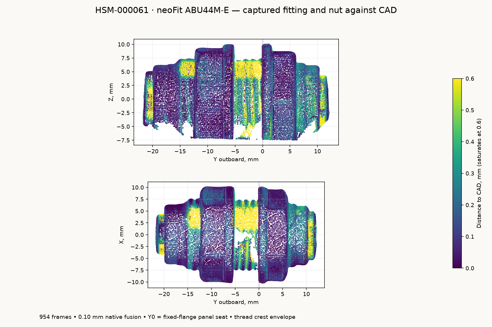

# neoFit ABU44M-E 4 mm bulkhead union

**HSM-000061**, black acetal ABU44M-E from
[Fresh Water Systems](https://www.freshwatersystems.com/products/neofit-acetal-black-bulkhead-connector-4mm-5-32-tube).
Both sockets take 4 mm OD tubing. Three fit each appliance: two black-marked
FLAVOR stations and one white-marked OVER station. The separate OVER tube is
white, with its own white rectangular chip and black word.

The native reference follows the sprayed specimen's MINI 2 scan. The STEP
contains two named solids: the fitting and its separate nut in the captured
position. Both are valid, and the two-shell STL is watertight. The bare fitting
retains the stepped end collars, fixed wrench hex, circular flange and barrel;
the nut retains its front lip, rounded outer envelope and wrench flats.

| Feature | Fitted reference, mm |
| --- | ---: |
| Release-face datum span | 33.288 |
| Outboard release face from panel seat | +11.827 |
| Inboard release face from panel seat | -21.461 |
| Fixed body hex, across flats | 17.104 |
| Nut hex, across flats | 18.003 |
| Fixed flange maximum diameter | 20.459 |
| Captured flange-to-nut face gap | 5.528 |

The shared fitting frame uses **+Y outboard**, +Z up and **Y0 at the fixed
flange's panel-seating face**. `port(1)` supplies the outboard mouth and `port(-1)`
the inboard mouth, each with its outward axis. The release-face coordinates are
coaxial representative datums fitted to the exposed face patches. Decimal
places identify reproducible geometry, not independently calibrated accuracy.

The [manufacturer dimensional sheet](source/bulkhead-union-dimensions.pdf)
([original](https://assets.freshwatersystems.com/image/upload/qnbgcy8djx3nj2weqz9v.pdf)),
ABU44M row, supplies **M15 x 1.5**, 32.4 mm nominal overall length, 8.1 mm bare
panel span, 6.5 mm nut length, nominal 17/18 mm hexes and 14.7 mm tube-stop
insertion depths. The model's exposed release faces follow the scan, including
the captured free collet positions. The barrel uses a smooth M15 crest envelope.
The nut's hidden bore is a clearance envelope, without a modeled mating thread.

The captured nut position is recorded independently of the installed clamp
position. The rear mounting stack is 6 mm: chip, wall and retained pocket
backing. The internal return, vent adapters and umbilical connection are
described in [drain assembly](/hardware/assembly/asse-drain.md).

## Capture and fit

Derek sprayed, putty-mounted, focused and rotated the specimen. Revo Scan 6.3.2
recorded **954 frames**, MINI 2 High Accuracy / Feature / Normal, colour and base
removal off, manual depth exposure 2, and a 120-250 mm range. Native fusion at
**0.10 mm** produced **383,471 points**. No native smoothing, isolation, hole
filling or rescaling is applied.

The single retained native project, frame database, calibration files, raw
preview, fused cloud and SHA-256 manifest are in
`~/Documents/3D Scans/2026-10-29-neofit-abu44m-bulkhead/`. That directory also
holds registered observations, portable STEP/STL files and a rendered preview.

[`analyze_scan.py`](analyze_scan.py) fits the marker-table plane and common end
axis from surface-normal rays, then fits exposed panel, nut and mouth planes.
Independent flat fits locate and clock the body and nut hexes. A fixed table
height above 17 mm removes the support and markers, retaining **206,384
observations** without selecting by distance to the CAD. Outward-facing
97.5th-percentile radii in 0.125 mm axial bins, a three-bin median and a 0.035 mm
radial simplification supply the local turned profiles.
[`scan-evidence.json`](scan-evidence.json) preserves source hashes, physical
selections, transforms and fit residuals.
[`reference-parameters.json`](reference-parameters.json) is the measurement
snapshot frozen into the model source so imported fitting geometry needs no
scan archive or JSON file at runtime.



[`scan-model-check.json`](scan-model-check.json) compares **36,481 observations**
at 0.25 mm sampling with the reopened STEP tessellated at 0.025 mm. Median
distance is **0.111 mm**, the 95th percentile **0.571 mm**, and **93.5%** lie
within 0.50 mm. The nut zone has a 95th-percentile discrepancy of **0.213 mm**;
thread roots and small mouth/collet details contain larger local differences.
All physically retained observations remain in the comparison. These values
are scan/model discrepancies, not manufacturing tolerances.

Putty-hidden lower sectors continue the fitted turned and hexagonal forms.
Thread grooves, collet finger slots and molded markings are omitted. Mouth
bevels, through bore and hidden nut clearance are display geometry. The scan
does not qualify thread engagement, tube retention, seals or printed mounting
fits. Paint thickness and absolute optical scale are not independently calibrated.

`build()` returns the bare fitting in the panel frame; `build_nut()` returns the
captured nut; `parts()` and `build_assembly()` expose both. `panel_hole_d()` retains
the nominal M15 clearance interface, and the footprint helpers use the fitted
exterior envelopes.

```sh
tools/cad-venv/bin/python hardware/reference/neofit-drain-bulkhead/analyze_scan.py
tools/cad-venv/bin/python hardware/reference/neofit-drain-bulkhead/neofit_drain_bulkhead.py
tools/cad-venv/bin/python hardware/reference/neofit-drain-bulkhead/validate_scan.py
```

The generator accepts `--stl /absolute/output/path.stl` for a portable mesh.
