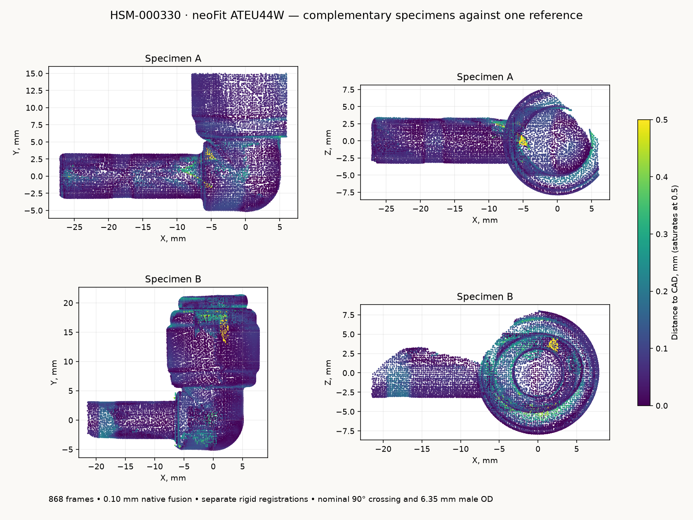

# neoFit ATEU44W 1/4-inch stem elbow

**HSM-000330**, the [white acetal stem elbow](https://www.freshwatersystems.com/products/neofit-acetal-white-stem-elbow-1-4-tube-x-1-4-stem).
The male stem enters another 1/4-inch push-fit socket and turns the path 90 degrees.
The reference follows two sprayed specimens mounted at opposite ends in one
MINI 2 capture. It contains an editable fixed body/stem and a separate oval
release collet. The STEP contains two valid solids; the portable STL contains
two watertight shells.

| Feature | Reference, mm |
| --- | ---: |
| Nominal male stem / female tube OD | 6.35 / 6.35 |
| Socket release face from axis crossing | +21.082 Y |
| Stem tip from axis crossing | -27.025 X |
| Stem shoulder from axis crossing | -6.114 X |
| Free stem, tip to shoulder | 20.912 |
| Maximum fixed collar diameter | 15.795 |
| Release-collet major / minor envelope | 12.229 / 10.289 |
| Published family female engagement | 16.891 |

The frame has its origin at the intersecting axes: **socket +Y, stem -X**.
The nominal 90-degree crossing and straight 6.35 mm male diameter are modeling
constraints. Independent specimen fits observe male radii of 3.196 and
3.110 mm; neither point set is rescaled. Coating, optical scale and specimen
variation are not independently calibrated. Decimal places identify the
reproducible reference, not part tolerances.

`socket()`, `stem_tip()`, `stem_shoulder()` and `seated_host_mouth(insertion)`
return positions and axes in this frame. `build()` returns the two named
CadQuery workplanes, `body_and_stem` and `release_collet`. `build_assembly()`
returns their named assembly. Existing NPZ files retain `v` and `f` arrays in
the same frame as the STEP.

## Capture and fitted form

Derek puttied the two specimens at opposite ends, sprayed, focused and rotated
them. Revo Scan 6.3.2 recorded **868 frames**, MINI 2 High Accuracy / Feature /
Normal, colour and base removal off, auto depth exposure observed at 1, and a
120-250 mm range. Native **0.10 mm** fusion produced **443,174 points**, without
native smoothing, isolation, hole filling or rescaling.

The single verified native project, raw frames, calibration, raw preview,
fused cloud and capture manifest are under
`~/Documents/3D Scans/2026-10-29-neofit-ateu44w-stem-elbow/`. The archive also
contains the two registered observation sets, portable STEP/STL files, preview,
model manifest and cleanup receipt.

[`analyze_scan.py`](analyze_scan.py) fits the marker-table plane and registers
each specimen separately using its straight stem and drafted socket collar.
Fixed physical bounds and a 15 mm table-height cutoff exclude the fixture.
Specimen A retains **124,435 observations**, including the free stem tip and
shoulder; B retains **146,909**, including the unobstructed socket nose and
release face. Source SHA-256 hashes, transforms, selections, face fits and
radial samples are in [`scan-evidence.json`](scan-evidence.json).

Outward-facing 95th-percentile radii in 0.10 mm bins, a three-bin median and
0.035 mm radial simplification supply the turned profiles. The collet's outer
ellipse is fitted independently and retains a circular nominal tube corridor.
The exposed outer bend supplies the round core; rotational and bend symmetry
continue obscured sectors. [`reference-parameters.json`](reference-parameters.json)
is frozen into [`neofit_stem_elbow.py`](neofit_stem_elbow.py), so layout imports
need no scan archive or measurement JSON at runtime.



[`scan-model-check.json`](scan-model-check.json) compares **48,171 observations**
at 0.25 mm sampling against the reopened STEP tessellated at 0.025 mm. Median
distance is **0.056 mm**, the 95th percentile **0.203 mm**, and **99.48%** lie
within 0.50 mm. The individual 95th percentiles are **0.168 mm** for A and
**0.230 mm** for B. Every physically retained observation remains in the check;
no points are rejected by distance to CAD. Local differences reach 2.085 mm
in the observed internal socket recess, where the reference uses a nominal
tube corridor. Shoulder relief and small collet details have larger local
residuals than the principal exterior bands. These are scan/model differences,
not manufacturing tolerances.

Two zero-area triangles at spherical poles are removed from the portable mesh;
no mesh holes are filled. Fine collet finger slots, lettering and mold seams
are omitted. The 4.3 mm flow passage, hidden transitions and collet underside
are display geometry. No seal, grip, release-stroke or pressure model is supplied.

## Receiving depth

The [manufacturer family drawing](source/stem-elbow-dimensions.pdf)
([original](https://assets.freshwatersystems.com/image/upload/s--ua8owcZg--/mlf6gjlehc9xpkjrbfw2.pdf)),
ATEU44 row, supplies 16.891 mm female engagement. Stem seating depends on the
**receiving socket**. Applied to this stem, that depth leaves a
4.021 mm shoulder gap and places the bend axis
10.134 mm from the host mouth.
The default unmeasured-host estimate is 12.7 mm insertion, with a 10-15 mm study
range. Supply the host's actual depth when known. The scan does not measure
internal tube stops or qualify another fitting's engagement.

[`model-dimensions.json`](model-dimensions.json) separates the scanned exterior,
nominal constraints and published family dimensions. Other material variants
have no tooling-equivalence claim from this capture.

Rebuild from the repository root:

```sh
tools/cad-venv/bin/python hardware/reference/neofit-stem-elbow/analyze_scan.py
tools/cad-venv/bin/python hardware/reference/neofit-stem-elbow/neofit_stem_elbow.py
tools/cad-venv/bin/python hardware/reference/neofit-stem-elbow/validate_scan.py
```

The generator accepts `--stl /absolute/output/path.stl` for a portable mesh.
