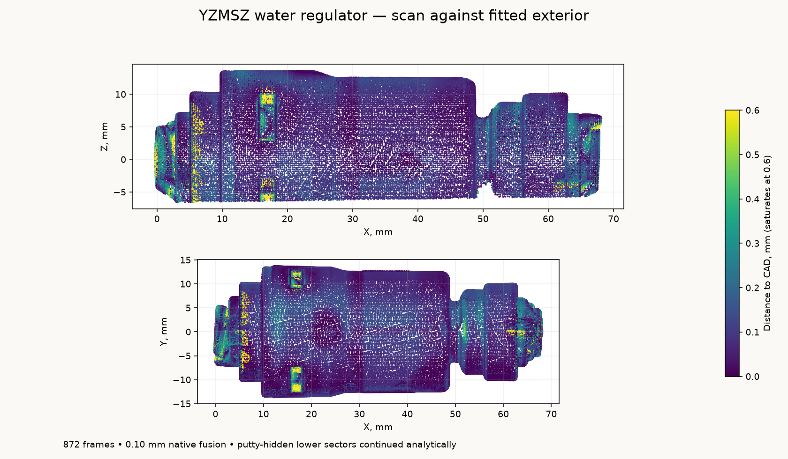

# YZMSZ fixed 0.3 MPa water regulator

The [YZMSZ regulator, ASIN B0CGS34P93](https://www.amazon.com/dp/B0CGS34P93),
is the **1/4 inch OD, non-adjustable 0.3 MPa** variant, with native axial
push-connect sockets and a nominal outlet pressure of **43.5 psi**. The listing
describes household water and reverse-osmosis applications with an
engineering-plastic housing.

The exterior is fitted to the painted specimen's native MINI 2 scan. The
reference retains the stepped cap, long housing, outlet neck, release-ring
envelopes, annular collet recesses and four cap windows.
`geometry/yzmsz-water-regulator.step` contains one named native solid; the
portable STL is watertight.

| Feature | Reference, mm |
| --- | ---: |
| Inlet-to-outlet release-face span | 68.117 |
| Maximum fitted diameter | 27.551 |
| Nominal tube OD | 6.35 |
| Tube insertion, estimate | 15 |

The native frame uses **+X flow**, from the broad/windowed inlet cap toward the
narrow-neck outlet. The fitted release-face datums are `(0,0,0)` and
`(68.117,0,0)`, with outward directions `−X` and `+X`. Both annular mouth faces
are named in the STEP. Decimal places identify reproducible datums, not calibrated
absolute accuracy. Release-collet extension is the captured free position.

## Capture and fit

Derek sprayed, putty-mounted and rotated the specimen. Revo Scan 6.3.2 recorded
**872 frames**, MINI 2 High Accuracy / Feature / Normal, colour and base removal
off, automatic depth exposure starting at 1, and a 120–250 mm range. Native
fusion at **0.10 mm** produced **573,810 points**. No native smoothing,
isolation, hole filling or rescaling is applied.

The single retained native project, frame database, calibration files, raw
preview, fused cloud and SHA-256 manifest are in
`~/Documents/3D Scans/2026-10-29-yzmsz-water-regulator/`. That directory also
holds registered observations and portable STEP/STL files.

[`analyze_scan.py`](analyze_scan.py) fits the broad marker-table plane and
long housing axis, including its small molding draft, at unit scale. It fits
the exposed release-face patches independently. A fixed table-height selection
above 15 mm removes the support and markers; **466,634 observations** remain.
No points are rejected by their distance to the CAD. The 95th-percentile
outward-facing radius in 0.15 mm axial bins, a three-bin median and a 0.04 mm
radial simplification supply the turned profile. Exposed cap-window bottoms
and release-recess profiles provide the localized details.
[`scan-evidence.json`](scan-evidence.json) preserves transforms, physical
selections, residuals and source hashes;
[`reference-parameters.json`](reference-parameters.json) supplies the model generator.



[`scan-model-check.json`](scan-model-check.json) compares **58,895 observations**
at 0.30 mm sampling against the reopened STEP tessellated at 0.025 mm. The median
distance is **0.082 mm**, the 95th percentile **0.364 mm**, and **97.0%** lie
within 0.50 mm. Collet finger details and partly visible mouth interiors contain
the larger local differences. These discrepancies are not manufacturing tolerances.

Putty-hidden lower sectors continue the fitted rotational exterior. Three
exposed cap-window bottoms constrain their approximate cuts; the obscured fourth
window follows opposing symmetry. Collet finger slots, embossed lettering and
the flow arrow are omitted. Blind mouth closures, annular-recess floors and
15 mm insertion are display estimates; the scan does not establish regulator
internals, seals, retention or pressure performance. Paint thickness and optical
scale are not independently calibrated.

`dimensions.json` separates published product facts from the fitted envelope.
`model.py` exposes `library()`, `instances()`, `ports()` and `mates()` using
the frozen NumPy mesh, without importing production CAD.

```sh
tools/cad-venv/bin/python hardware/reference/yzmsz-water-regulator/analyze_scan.py
tools/cad-venv/bin/python hardware/reference/yzmsz-water-regulator/build.py
tools/cad-venv/bin/python hardware/reference/yzmsz-water-regulator/validate_scan.py
```
