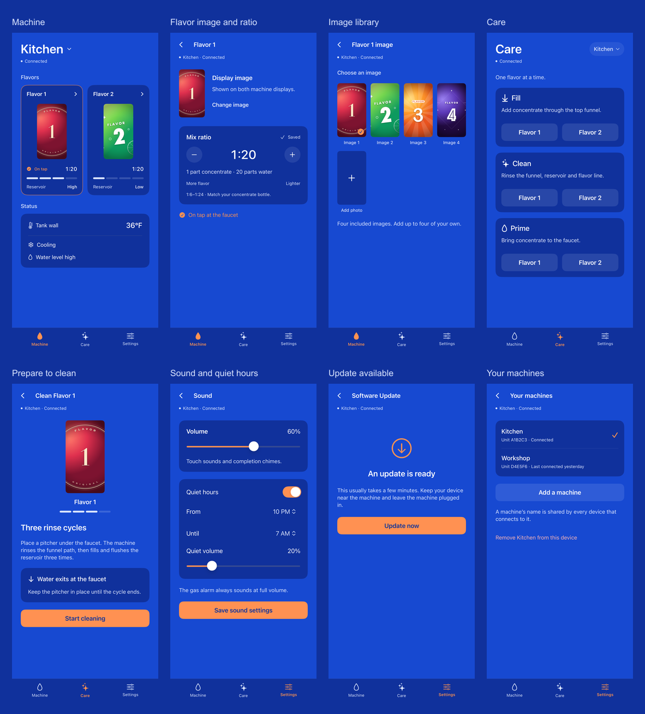

# Adaptive appliance app proposal

An executable SwiftUI proposal for the integrated soda machine's complete iOS
app. The product has three destinations: **Machine**, **Care**, and **Settings**.
The layout uses the existing Big Blue palette, SF Symbols, native SwiftUI text
and controls, and the app's bundled flavor art.



## Review

- [Native detail and screen index](preview/README.md): focused 2× lossless renders
  for judging text and visual detail, plus all 37 screens and states across seven
  canvases in a compact browsing matrix.
- [Production integration plan](INTEGRATION.md): firmware capability mapping,
  authoritative state, Bluetooth routing, migration, and operation behavior.
- [Views](Sources/StudyViews.swift): the native layout source behind the images.

The screenshots are content renders from the installed iOS 18.5 Simulator runtime.
Each canvas is a specified size in points, captured at 2×. They omit device bezels,
status bars, keyboards, system photo/accessory sheets, and device-specific safe-area
masks. The production view consumes the system's safe area; these canvases isolate
the layout within the available region. Duo's iOS 27.1 system presentation and
hardware safe areas need verification on that runtime or device. The installed
runtime cannot boot the Duo device type.

The fixture's Kitchen machine, unit IDs, temperatures, levels, ratios, connection
conditions, and transfer progress are sample data. Views are real SwiftUI; product
effects are fixtures. Buttons illustrate navigation and local edits. Ratio and
name drafts apply with Save; active flavor changes through Use at faucet.
Connection state survives navigation, and machine-dependent controls are disabled
offline. Local edits disappear when the study restarts. The study
does not connect to a machine, select a real photo, crop or transfer pixels, run a
pump, write machine settings, or install software. The crop mockup specifies the adaptive
placement of the existing crop pipeline; its sample framing is fixed.

## Product map

| Destination | Screens and behavior |
| --- | --- |
| Machine | Selected machine and connection state; two flavor faces, active flavor, coarse reservoir gauges and ratios; tank-wall temperature, cooling and water-level state |
| Flavor | Selected channel's image and concentrate-to-water ratio; explicit Save ratio; explicit Use at faucet |
| Images | Four factory images and up to four custom images; native photo selection, one 43:80 crop, upload progress, retry and cancellation |
| Care | Choose Fill, Clean, or Prime, then the flavor; preparation, authoritative progress and results |
| Fill | Draw concentrate from the top funnel; explicit start/stop; timed end, full, and stopped outcomes |
| Clean | Rinse the funnel path, then three reservoir rinse rounds; estimated time, current stage, stop confirmation and operation-specific results |
| Prime | Open the selected flavor's Prime session on the enclosure; hold on a physical machine display; phone follows the shared state and can exit |
| Settings | Machine name, sound, quiet hours, aggregate software update, and Your machines |
| Your machines | Current and known machines, status/read time, selection, add, rename, and confirmed removal from this device |
| Setup and demo | Native accessory setup near the faucet; an appliance demo using the same screens |

The proposal's app model is appliance-only. Its demo uses appliance fixtures.
Saved real prototype records have an explicit unsupported/removal path and are
never relabeled as appliances. The production changes and persistence migration
are defined in the integration plan; this study is a separate target.

## Layout rules

The app responds to **available width and height**, independent of device name.
Navigation, selected machine/channel, in-progress edits, and operations live above
the layout branches so folding, rotation, or window resizing preserves them.

| Available region | Proposed composition |
| --- | --- |
| Narrow phone or window | Three bottom destinations; two flavor cards; machine readings below; stacked form and preparation sections |
| Short, wide phone / open Duo | Same destinations; flavor cards beside machine readings; compact horizontal flavor cards in short windows; two-column flavor, crop and preparation views where their content fits |
| Large window, at least 1000 pt wide | 216 pt sidebar; same destinations and routes; content bounded to 840 pt; settings forms bounded to 560 pt |
| Reduced height | Content scrolls; crop instructions and action sit beside the exact tall framing window; navigation retains its own region |
| Accessibility text | Single-column content and compact navigation; scalable semantic text; no fixed-height body panels |

Body content scrolls at every size. A shorter window reveals less content without
discarding controls. Images retain the machine's 43:80 framing and bounded sizes;
they are not stretched into the available iPad space. The home screen's two cards
remain a two-item composition rather than becoming extra empty grid columns.
The selected flavor has an explicit On tap marker and a fine accent outline.
Navigation uses a quiet icon/text selection. Machine identity and connection status
appear together in the compact header or the wide sidebar. Settings use aligned
icon gutters and inset separators; Care actions have a visible secondary surface.

| Render canvas | Size, pt |
| --- | --- |
| iPhone portrait | 402 × 874 |
| Duo cover | 466 × 678 |
| Duo open | 890 × 626 |
| iPad portrait | 834 × 1194 |
| iPad landscape | 1194 × 834 |
| Narrow resizable window | 320 × 720 |
| iPhone landscape | 874 × 402 |

Duo canvas aspect ratios derive from
[Apple's display specifications](https://www.apple.com/iphone-duo/specs/), at 3×
for the cover and expanded layouts. These are review canvases, not assertions
about every available display mode. The adaptation follows Apple's
[layout](https://developer.apple.com/design/human-interface-guidelines/layout)
and [split-view](https://developer.apple.com/design/human-interface-guidelines/split-views)
guidance for resizable windows.

## State and implementation contract

The home shows coarse levels rather than percentages, milliliters or servings.
Tank wall is labeled as the measured surface, with no outlet-water temperature
claim. Missing readings remain unknown. Cached readings retain their time.
The ratio is concentrate : water, 1:6 through 1:24. Smaller denominators make a
stronger mix.

The main board owns configuration, selection and operation state. Starting,
Stopping, and Saved are distinct from a BLE write succeeding. Fill/Clean can run
after a phone disconnects, so lost contact says the cycle **may still be running**.
Prime retains the enclosure's session and local physical holds. Software Update
uses one overall transfer, restart and version verification sequence for the whole
machine.

Identity, images, and aggregate updates have existing phone transports. Telemetry,
ratio, selection, Care, and sound need the typed Bluetooth bridge described in
the integration plan. Consumer screens use those existing appliance concepts.
The firmware's factory/bench Dry/Purge, prototype usage charts and unmeasured
consumable estimates are outside this app map.

System accessory setup, photo permissions and selection, confirmation dialogs,
keyboard behavior, unavailable custom-image placeholders, full custom storage,
queued uploads, pending commands and refusal reasons reuse or extend the current
native flows. The screen index contains representative failure/progress states;
the integration plan defines their remaining variants. Launch art and the first
frame must be coordinated with the compact header/onboarding layout in the
production implementation.

## Reproduce or run

Requires macOS, Xcode, XcodeGen and an installed iOS 18.5 Simulator runtime.

```sh
python3 ios/AdaptiveStudy/capture.py
node ios/AdaptiveStudy/review.mjs
```

`capture.py --quick` renders Machine, Sound, and Crop at three sizes. The full run
captures the matrix into the ignored `renders/` directory. `review.mjs` writes
the compact 1× WebP matrix, overview, and index into `preview/`, and selected
native 2× lossless WebP copies into `preview/detail/`.
Use `capture.py --routes home,offline` to refresh only those routes while retaining
the other captured screens.

To package the in-chat review, pass `--inline-dir <current-chat-visualization-dir>`
to `review.mjs`. It packages focused phone and aspect-ratio reviews with native
2× lossless images and the shared mobile theme helper. If the inline size limit
requires it, a review is split across fragments without reducing image quality.
Those review controls choose a screen/window or show the image at actual point
size; they are outside the proposed product. Fit is the initial viewing mode.

Open the generated `SodaMachineStudy.xcodeproj` to run the local fixture app. Its
bundle ID, data container, generated project and simulator are separate from the
production app. These are manual study tools and add nothing to automatic builds
or commits.
